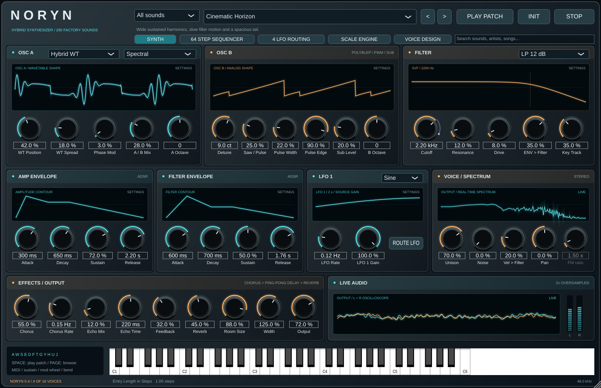
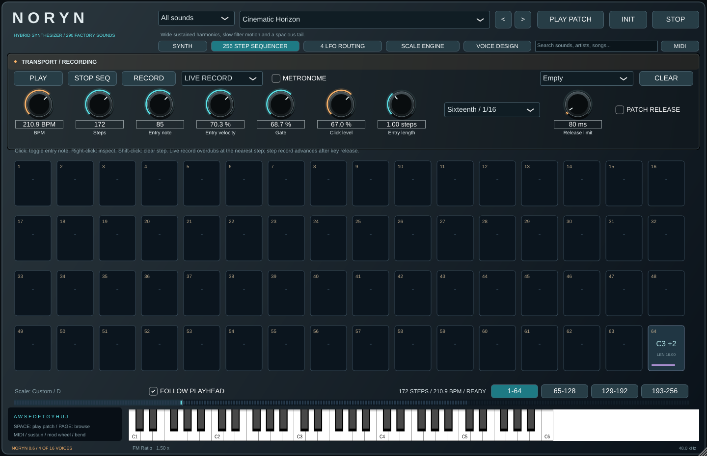
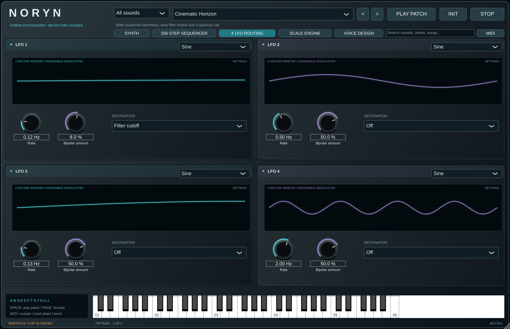
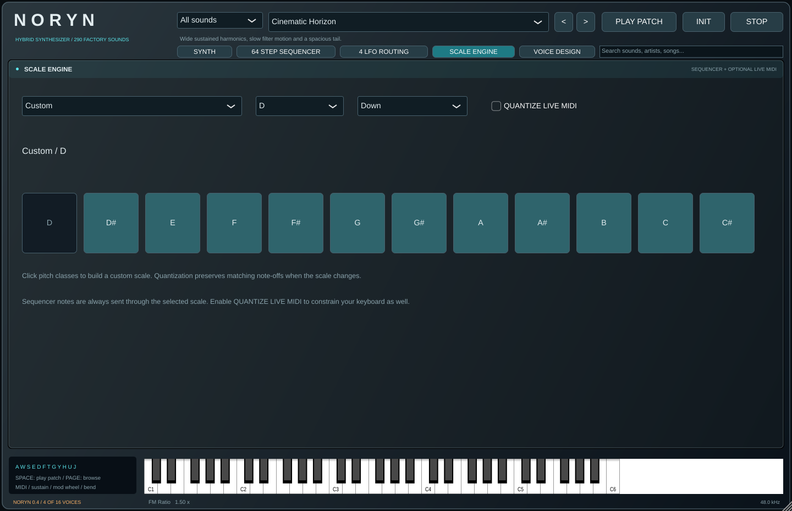

# NORYN 0.3 — Hybrid Synthesizer

Native Linux VST3 instrument and standalone synthesizer. The interface takes cues from the supplied NORYN concept and the SONAVYRE module's dark panels and colored traces. This is an original instrument built with JUCE and custom DSP, not a circuit emulation of a particular commercial synth.

## Screenshots

| Synthesizer | 64-step sequencer |
| --- | --- |
|  |  |
| **Four LFOs** | **Scale engine** |
|  |  |

## Launch

Run `./run.sh`. Build outputs:

- `build/Noryn_artefacts/Release/Standalone/NORYN`
- `build/Noryn_artefacts/Release/VST3/NORYN.vst3` — copy the complete bundle into `~/.vst3/` and rescan your DAW.

Choose audio and MIDI devices in the standalone Options menu. Play a MIDI controller, click the piano, or use A/W/S/E/D/F/T/G/Y/H/U/J. Space auditions the current patch; Page Up/Down browse. STOP clears notes, transport, recording and effect tails. Pitch bend spans two semitones; sustain and velocity work. CC1 opens the filter by up to three octaves; it does not create a hidden LFO route.

## Knobs and displays

All knobs use a 250-pixel full sweep. Hold Shift before dragging for fine adjustment. Values **clamp at minimum and maximum**; they do not wrap around. Double-click resetting is disabled. Right-click for an explicit reset. Values can be typed with units, e.g. `350 Hz`, `4 kHz`, `120 ms`, `1.5 s`, `35 %` or `-12 ct`.

A violet outer marker/arc shows the effective value of a control being modulated. The manually set knob value stays fixed. Hovering identifies the LFO sources. Only explicitly assigned LFO destinations show modulation. Other LFOs can independently target other controls; inspect all four assignments if several controls move.

The oscillator, filter, ADSR and LFO graphs are **setting views**, not audio scopes: they stay still when a note plays and change only with their relevant controls. OSC B never changes OSC A's display. The LFO graph shows a fixed two-second window and responds to rate, waveform and source gain/amount. OSC A's static neighboring traces show wavetable spread. OSC B's pulse edge changes the rounded/square character of its pulse. Controls that do not apply to the selected engine are dimmed.

Only the dedicated stereo output scope, FFT spectrum and level meters follow playback. These update at 30 fps from actual audio; they are not decorative waveform animations. The spectrum uses a 1,024-point Hann window. The filter graph approximates the response at the base cutoff/resonance/mode; it is not a measured response analyzer.

## Sounds

96 editable factory patches, twelve each in Pads, Basses, Leads, Keys, Plucks, Textures, Motion and Brass & Strings, plus Init. Categories filter the browser. Arrows cycle within a category. PLAY PATCH auditions a suitable note or chord. [PRESETS.md](PRESETS.md) lists the bank.

Five synthesis engines make the bank more varied:

- **Hybrid WT:** four interpolated 16-frame wavetable families: Classic, Spectral, Formant and Digital. Seven harmonic bands; static frame spread across unison layers; phase modulation.
- **FM Operator:** sine carrier and ratio-tuned modulator, with filter-envelope-shaped index, for electric keys, bells and metallic leads.
- **Plucked String:** a noise-excited, fractionally tuned feedback delay with damping for string-like plucks.
- **Drawbar Organ:** additive partial mixtures and a fast sustained contour.
- **Analog Stack:** detuned triangle/saw layers alongside the polyBLEP analog oscillator.

Six oscillators per note at full unison, 16-note polyphony, stereo spread, independent oscillator octaves, sine sub and noise. Oscillator B blends saw and variable-width pulse, with adjustable pulse edge. A resonant state-variable filter offers 12/24 dB low pass, high pass and band pass, drive, key tracking, velocity and an independent ADSR. The oscillator/drive/filter path runs at 2x sample rate and reports its latency to the host.

Stereo chorus, variable-time ping-pong echo, feedback, algorithmic reverb, stereo width and output gain complete the chain. Output soft saturation bounds peaks below full scale. The master also controls metronome output. Preset loudness depends on pitch, velocity, voicing and envelope stages.

The 24 dB mode cascades state-variable stages; it is not a transistor ladder model. Extreme phase/FM settings can still alias despite oversampling. These are custom algorithms; “best free synth DSP” is not a claim this project makes.

## Four LFOs

Open **4 LFO ROUTING** or use ROUTE LFO. Each LFO has its own rate, shape, bipolar amount and one destination:

Off, filter cutoff, resonance, WT position, A/B mix, saw/pulse blend, pulse width, B detune, phase-modulation index, unison, drive, noise, sub, amplitude or pan.

There are **no legacy hidden sends** to the filter or oscillators. Off means no modulation. Changing a destination removes the old assignment. LFO 1 additionally has a source-gain control on the Synth page; it scales that LFO's assigned amount. WT Spread and Pulse Edge are static tone controls, not extra LFO sends. Older session states are migrated to this explicit-routing model.

LFOs are per-voice and restart with a note. Modulation indicators show the most recently played active voice's effective values. Shape displays do not move with LFO phase or incoming audio.

## 64-step sequencer

Open **64 STEP SEQUENCER**:

- PLAY / STOP SEQ control transport. BPM spans 30–300.
- Length spans 1–64 steps. Division is quarter, eighth, sixteenth or thirty-second notes.
- Click a pad to toggle the entry note. Right-click a pad to inspect its note/velocity. Shift-click clears it. Pads can hold chords; MIDI recording and MCP can enter several notes in a step.
- Entry velocity, note length in steps, and global gate control articulation.
- **LIVE RECORD:** enable RECORD to start transport and overdub incoming MIDI on the nearest step. Held note durations are recorded.
- **STEP RECORD:** RECORD accepts a note or chord into the selected step; releasing its keys advances the cursor. Transport stays stopped.
- METRONOME and Click Level provide a quarter-note click with a bar accent. The beat clock remains independent of pattern length.
- Empty, Beat pulse, Acid steps, Dream arpeggio and Chord walk provide starting patterns.

Playback uses MIDI channel 16 internally so its note-offs do not stop live channel-1 notes. Tempo is internal; DAW transport/PPQ sync and sequencer MIDI output are not implemented. The sequencer, scale and tempo are preserved when changing factory sounds. Full session state and user presets recall the pattern and control settings; transport does not auto-start on reopening.

## Scale engine

**SCALE ENGINE** includes all twelve roots and 37 choices: chromatic, major/minor and their modes, harmonic/melodic minor, major/minor pentatonic, blues, whole-tone, both diminished forms, harmonic/double-harmonic major, Phrygian/Lydian dominant, altered, Hungarian, Neapolitan, Persian, Japanese pentatonic forms, Egyptian, bebop, augmented, tritone and Custom.

Click pitch classes to build any nonempty custom twelve-tone scale. Choose nearest, up or down quantization. Sequencer notes use the scale; live MIDI quantization is optional. Matching note-offs are retained when root/scale changes, and colliding quantized notes use reference counts to avoid stuck or prematurely released notes.

## User presets and MCP

User patches are saved locally in `~/.config/NORYN/presets` and appear in the browser under User patches. Session saves include all 72 automatable parameters, preset identity and the complete pattern. Preset creation/loading is available through MCP; the standalone Options menu also supports sound-state saving.

The [NORYN Control plugin](mcp/README.md) uses the real Cloudflare Code Mode SDK and Dynamic Worker sandbox. One `code` MCP tool composes native operations for inspecting/editing sounds, saving presets, programming sequences/chord progressions, choosing scales, mapping LFOs and transport. It runs locally through Cloudflare's workerd runtime; no hosted Cloudflare deployment or account is required for this local setup.

The native bridge processes commands on the message thread and uses private per-instance directories. It does not poll files or wait on MCP in the audio callback. Local HTTP services bind to loopback and require private bearer tokens; credentials are excluded from packages. The plugin bootstrap installs its locked Node dependencies and starts the local services if needed. Open the synth before calling its native operations.

`Code Mode Glass Orbit` is a saved example created and recalled through Code Mode: a D-major I–vi–IV–V progression at 110 BPM, using an FM key sound and LFO 2 on cutoff. Select it under User patches, then open the sequencer to play it.

## Build and verify

Use the repository or matching source archive for builds. Requires CMake 3.22+, C++17, Git and internet for the initial JUCE 8.0.6 fetch. Debian/Ubuntu dependencies include ALSA, X11/Xrandr/Xinerama/Xcursor, FreeType, Fontconfig and OpenGL development packages.

```sh
cmake -S . -B build -DCMAKE_BUILD_TYPE=Release
cmake --build build --target Noryn_All NorynSmoke -j2
NORYN_NO_MCP=1 xvfb-run -a build/NorynSmoke_artefacts/Release/NorynSmoke .
```

The checks cover 58 sound controls with rendered audio comparisons; every UI parameter binding and minimum; disabled wraparound/accidental reset; all 96 presets and five engines; full parameter/pattern recall; 64-step timing at 120/240 BPM; live and chord step recording; exhaustive scale/root/direction/MIDI-note bounds; collision-safe note-offs; matching scope/audio samples; static setting graphs; OSC-display independence; LFO rate/depth graph response; moving modulation indicators with fixed base values; destination isolation and no audio modulation with routes Off; and finite output at 44.1/48/96 kHz with 16/64/127/512-sample blocks.

Reports: `validation.json`, `control-sensitivity.csv`, `native-knob-verification.json`. Screenshots: `preview.png`, `sequencer.png`, `lfos.png`, `scales.png`, `preview-small.png`. `demo.wav` samples the eight preset categories. Native mouse testing also verifies that dragging 70% below the minimum stays at zero after release/double-click. Offline verification does not replace listening or validation across DAWs.

NORYN is released under [AGPL-3.0](LICENSE). JUCE uses its AGPLv3 open-source option in this build; dependency notices are in [THIRD_PARTY.md](THIRD_PARTY.md). Binary releases include the license and a matching source archive with JUCE 8.0.6. Windows/macOS binaries require builds on those platforms. User wavetable import, a multi-slot arbitrary modulation matrix and host tempo sync remain future work.
